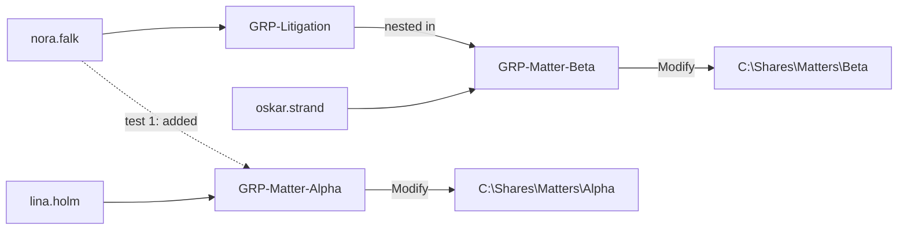
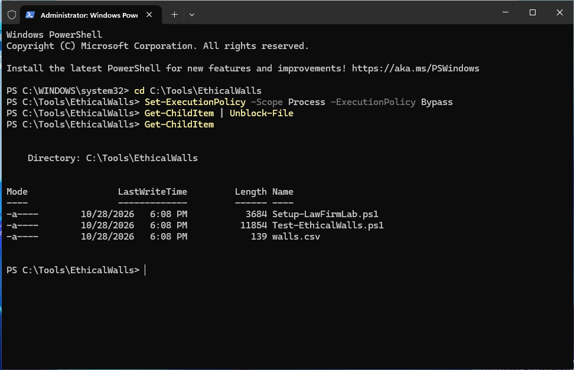
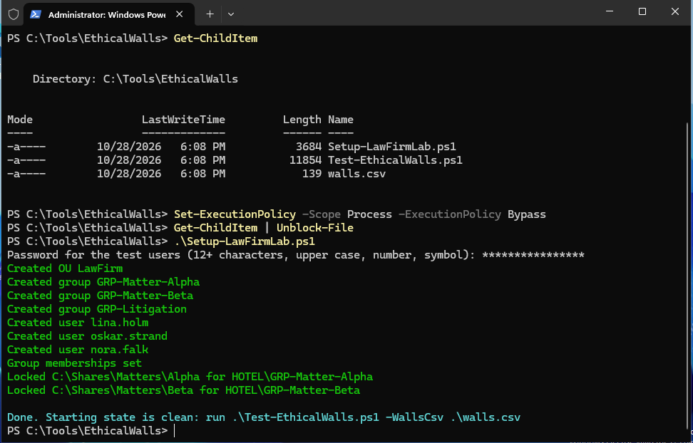
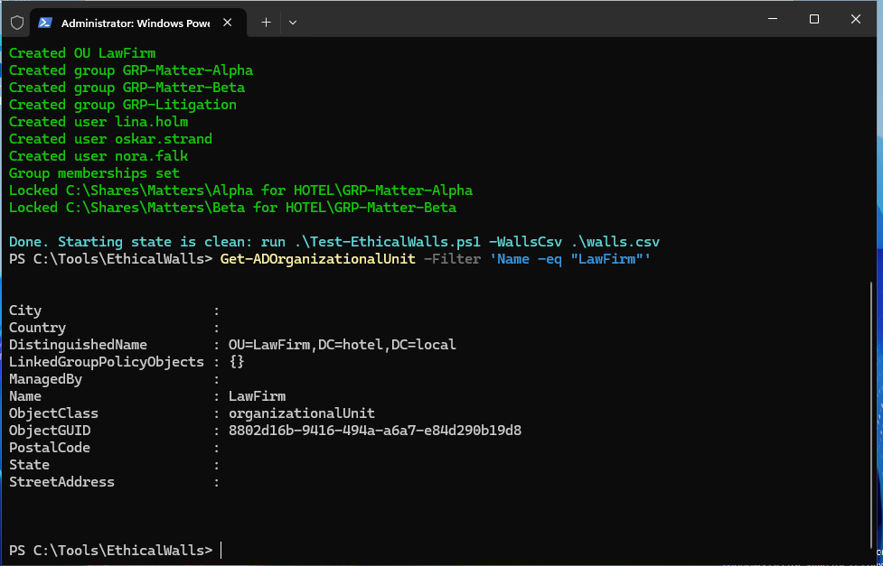
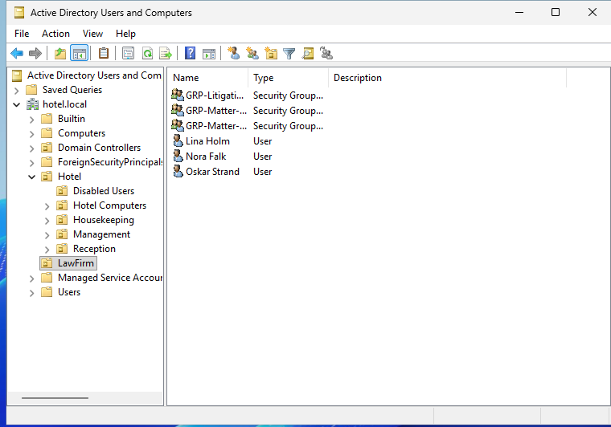
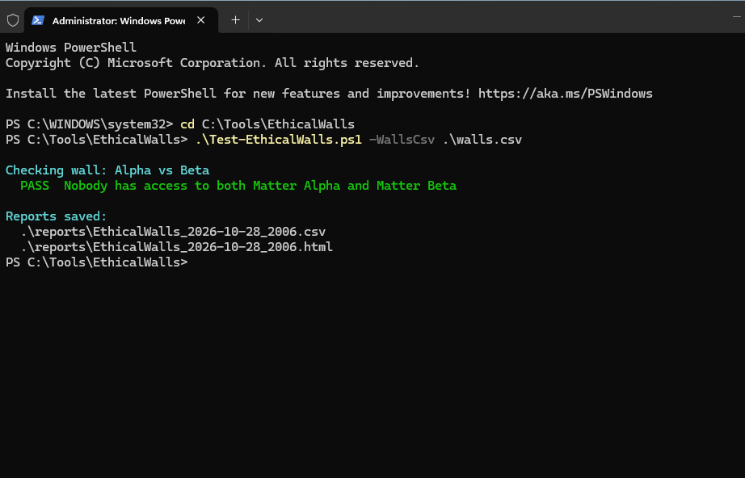
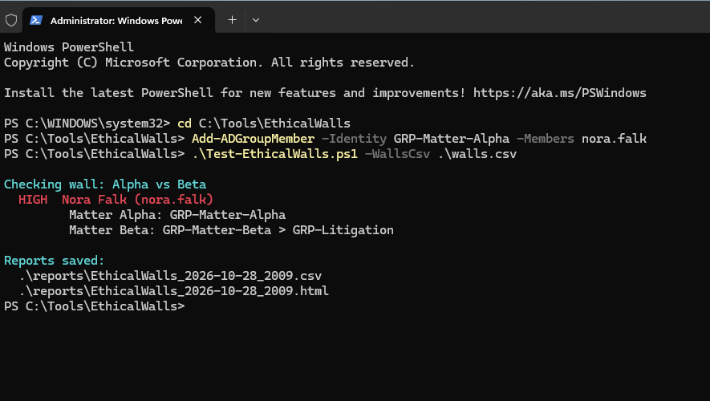
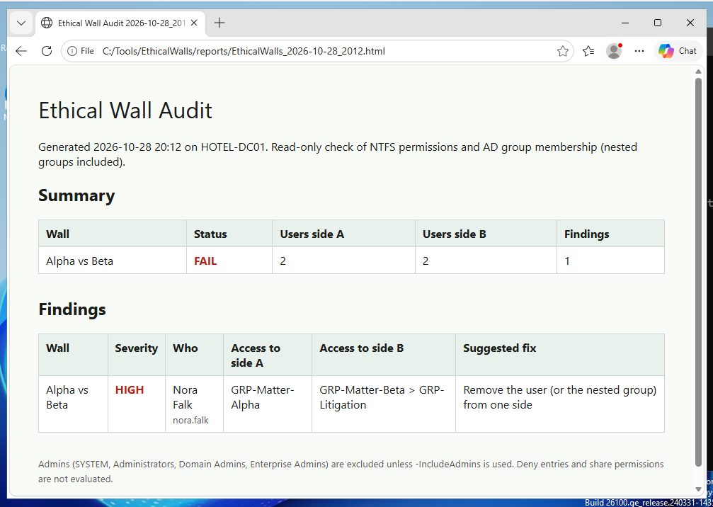
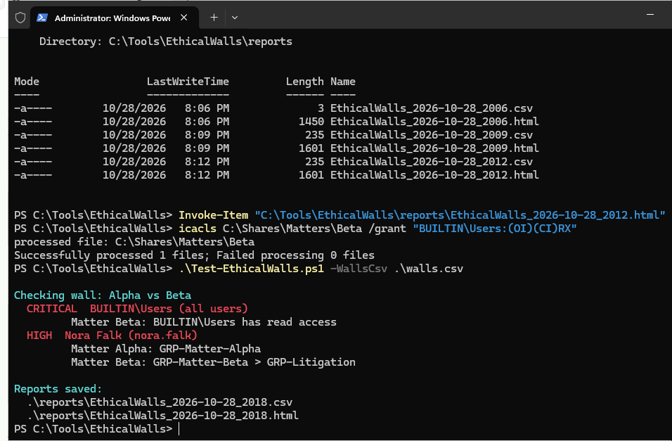
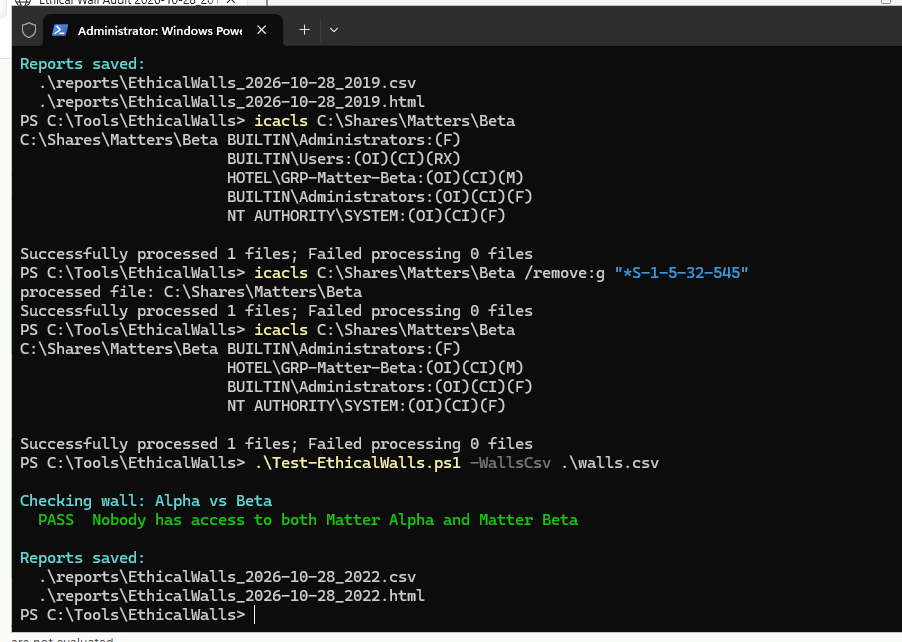

# Lab report: Ethical Wall Auditor

**Date:** 28 October 2026
**Environment:** Windows Server VM `HOTEL-DC01`, domain `hotel.local` (my home lab)
**Tools:** PowerShell, Active Directory module, `icacls`, Active Directory Users and Computers

## Summary

I tested a PowerShell auditor that checks whether anyone can reach both sides of an ethical wall. I built a
fictional law firm in my lab domain, ran a clean baseline, broke the wall on purpose in two different ways,
checked that the tool caught both, fixed them and ran it again.

| # | Time | What I did | Result | Evidence |
|---|---|---|---|---|
| 1 | 20:06 | Baseline, nothing changed | PASS | [05](screenshots/05-baseline-pass.png) |
| 2 | 20:09 | Added Nora to the Alpha group. She already reached Beta through a nested group | HIGH | [06](screenshots/06-nested-group-conflict.png), [07](screenshots/07-conflict-html-report.png) |
| 3 | 20:18 | Gave `BUILTIN\Users` read access to the Beta folder | CRITICAL | [08](screenshots/08-folder-permission-critical.png) |
| 4 | 20:19 | First fix attempt | Still CRITICAL: the permission was still there | |
| 5 | 20:22 | Removed the permission by SID, checked the ACL, removed Nora from Alpha | PASS | [09](screenshots/09-acl-fix-and-pass.png) |

Times come from the timestamped report files the auditor writes (`EthicalWalls_2026-10-28_HHMM.csv/.html`).

## Why I built this

Law firms have to keep teams that work for clients with conflicting interests apart. In IT, that wall is usually
just security groups and folder permissions, and it can break quietly: someone is added to the wrong group, or
gets access through a nested group nobody remembers. I wanted a project that connects what I've learned about
Active Directory, NTFS permissions and PowerShell to a real problem, and that I could show step by step.

This is a lab project with fictional users and matters, not production experience.

## Lab design

I created the law firm as its own OU in my existing lab domain, next to the hotel OUs from my earlier lab.



* **Users:** `lina.holm` (Alpha team), `oskar.strand` (Beta team), `nora.falk` (Litigation)
* **Groups:** `GRP-Matter-Alpha`, `GRP-Matter-Beta`, `GRP-Litigation`. Litigation is a member of Matter-Beta, so Nora reaches Beta indirectly.
* **Folders:** inheritance removed, so only SYSTEM, Administrators and the matter group have access.
* **The wall** (`walls.csv`): nobody may have access to both Alpha and Beta.

```csv
WallName,SideA_Name,SideA_Path,SideB_Name,SideB_Path
Alpha vs Beta,Matter Alpha,C:\Shares\Matters\Alpha,Matter Beta,C:\Shares\Matters\Beta
```

## Steps

### 1. Prepare the files

I copied the three files to `C:\Tools\EthicalWalls` on the domain controller. Scripts downloaded from the
internet are blocked by default, so I allowed scripts for this PowerShell session only and unblocked the files.

```powershell
cd C:\Tools\EthicalWalls
Set-ExecutionPolicy -Scope Process -ExecutionPolicy Bypass
Get-ChildItem | Unblock-File
```



### 2. Build the fictional law firm

`Setup-LawFirmLab.ps1` creates the OU, groups, users, nesting and locked folders. It asks for the test users'
password without showing it on screen.

```powershell
.\Setup-LawFirmLab.ps1
```



I checked the result two ways, in PowerShell and in Active Directory Users and Computers:

```powershell
Get-ADOrganizationalUnit -Filter 'Name -eq "LawFirm"'
```





### 3. Baseline audit

Before breaking anything, I needed proof the starting state was clean. Otherwise I couldn't tell whether a
later finding came from my change or was already there.

```powershell
.\Test-EthicalWalls.ps1 -WallsCsv .\walls.csv
```

Result: **PASS**, nobody has access to both Matter Alpha and Matter Beta.



### 4. Test 1: conflict through a nested group

This is the hard case. Nora isn't a direct member of the Beta group, she gets in through `GRP-Litigation`.
Looking only at direct group members wouldn't catch it.

```powershell
Add-ADGroupMember -Identity GRP-Matter-Alpha -Members nora.falk
.\Test-EthicalWalls.ps1 -WallsCsv .\walls.csv
```

Result: **HIGH** for Nora Falk, with both access paths:

* Matter Alpha: `GRP-Matter-Alpha`
* Matter Beta: `GRP-Matter-Beta > GRP-Litigation`



The auditor also writes a CSV and an HTML report to `.\reports` with a suggested fix:

```powershell
Invoke-Item .\reports\EthicalWalls_2026-10-28_2012.html
```



### 5. Test 2: a folder open to everyone

A different kind of mistake: a broad group gets access to a matter folder, for example when someone fixes an
access problem by adding *Users*. Then the wall doesn't exist for anyone.

```powershell
icacls C:\Shares\Matters\Beta /grant "BUILTIN\Users:(OI)(CI)RX"
.\Test-EthicalWalls.ps1 -WallsCsv .\walls.csv
```

Result: **CRITICAL**, `BUILTIN\Users` has read access to Matter Beta. Nora's HIGH finding is still listed
because I hadn't removed her yet.



### 6. Fix and verify

```powershell
Remove-ADGroupMember -Identity GRP-Matter-Alpha -Members nora.falk -Confirm:$false
icacls C:\Shares\Matters\Beta /remove:g "BUILTIN\Users"
.\Test-EthicalWalls.ps1 -WallsCsv .\walls.csv
```

The audit at 20:19 still showed the CRITICAL finding. See *Troubleshooting* below. After removing the
permission by SID and checking the ACL, the audit passed again at 20:22.



## Troubleshooting: the permission that didn't go away

**Symptom:** after my fix, the auditor still reported `CRITICAL BUILTIN\Users`.

**What I checked:** instead of assuming the tool was wrong, I looked at the folder's actual permissions:

```powershell
icacls C:\Shares\Matters\Beta
```

`BUILTIN\Users:(OI)(CI)(RX)` was still there. The auditor was right; my fix hadn't worked.

**Fix:** I removed the entry by the group's well-known SID instead of its name. `S-1-5-32-545` is
*BUILTIN\Users* on every Windows machine, and the `*` tells icacls it's a SID:

```powershell
icacls C:\Shares\Matters\Beta /remove:g "*S-1-5-32-545"
icacls C:\Shares\Matters\Beta
```

The Users entry was gone. Only Administrators, `HOTEL\GRP-Matter-Beta` and SYSTEM were left. Then I ran the
audit again and got PASS.

**What I took from it:** "Successfully processed 1 files" only means icacls ran without an error, not that the
permission changed. I now check the actual ACL after every permission change, then confirm with the audit.
SIDs are also safer than names in scripts because they're the same on every machine and in every language.

## Findings and fixes

| Finding | Severity | Cause | Fix | Verified by |
|---|---|---|---|---|
| Nora can reach both matters | HIGH | Direct member of Alpha + nested member of Beta via Litigation | `Remove-ADGroupMember` from Alpha | Audit PASS 20:22 |
| Beta folder readable by all users | CRITICAL | `BUILTIN\Users` granted read on the folder | `icacls /remove:g "*S-1-5-32-545"` | `icacls` output + audit PASS 20:22 |

## What this shows

* Creating and organising AD objects with PowerShell (OUs, users, security groups, nested groups)
* NTFS permissions: inheritance, `(OI)(CI)` flags, reading and changing ACLs with `icacls`
* Thinking like an auditor: baseline first, change one thing, confirm it's detected, fix, verify
* Not trusting a success message: checking the real state before moving on
* Writing reports (CSV and HTML) that someone outside IT can read

## Limitations

* Admin accounts (SYSTEM, Administrators, Domain Admins, Enterprise Admins) are skipped by default, since IT
  is expected to have access. `-IncludeAdmins` turns them on.
* **Deny** entries and **share** permissions aren't evaluated, so results show *potential* access.
* Only the folders listed in `walls.csv` are checked, not files with their own permissions further down.
* Tested in a lab with one wall and three users, not at law-firm scale.

## Next steps

* Test the MEDIUM case: a **disabled** user who still has access to both sides
* Run it as a scheduled task and alert on exit code 1
* Add more walls to `walls.csv` and test with deeper nesting
* Add share-permission checks
